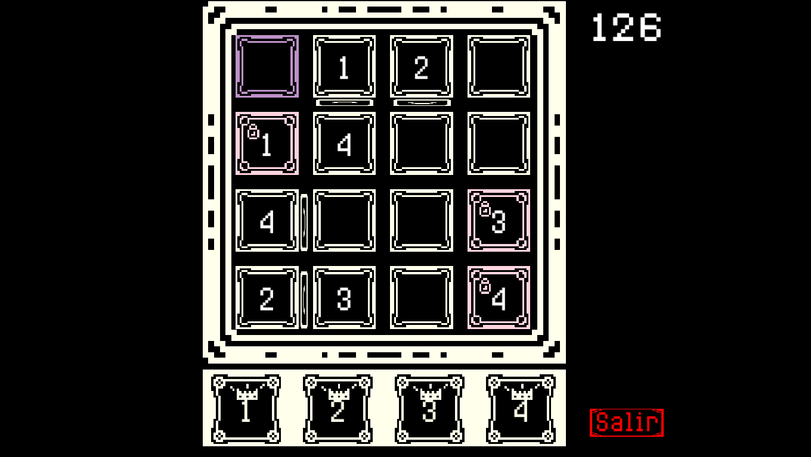

  # Bienvenido a mi portafolio🌱

 
  

 - ☝️Este portafolio es de uso temporal mientras trabajo en uno.
 - 👋Mi nombre es Hamlet Cegarra, en redes me encuentras como HacheP_06.
  
 - ✏️Soy un programador, ilustrador digital y editor(amateur).

 - 🤸Soy una persona creativa, apasionada y dedicada a lo que me gusta.
 
 - ⚡Doy el 120% en todo lo que hago.

 - 💡Interesado siempre en aprender algo nuevo.

<h1>Lenguajes que manejo</h1>

         
      

<h1>Programas que utilizo</h1>

         
      

<h1>Proyectos destacados</h1>

  

  
  
  
  

