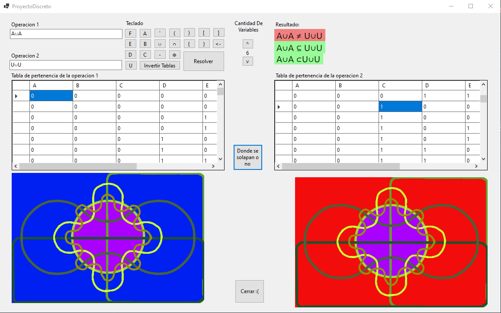

  # Bienvenid@ a mi portafolio🌱

 
  

 - ☝️Este portafolio es de uso temporal mientras trabajo en uno.
 - 👋Mi nombre es Hamlet Cegarra, en redes me encuentras como HacheP_06.
  
 - ✏️Soy un programador, ilustrador digital y editor(amateur).

 - 🤸Soy una persona creativa, apasionada y dedicada a lo que me gusta.
 
 - ⚡Doy el 120% en todo lo que hago y priorizo la calidad en vez de la cantidad.

 - 💡Interesado siempre en aprender algo nuevo.

<h1>Lenguajes que manejo</h1>

         
      

<h1>Programas que utilizo</h1>

         
      

<h1>Proyectos destacados</h1>
  

  

    <h2>Futoshiji(2025)</h2>
     
    Futoshiji es un juego japones muy similar al sudoku, donde sus principales es la cantidad de casillas y las desigualdades que le añaden     mas desafio al juego. Este proyecto es una recreacion didactica del mismo para un mejor entendimiento del motor Unity y del lenguaje C#. 
     
    > Repositorio: https://github.com/HacheP06/Futoshiki.git
     
    <h3>Programa y lenguaje empleado</h3>
    
    
  
  

  

  

    <h2>Graficador de diagrama de ventt-edward(2025)</h2>
     
     
    > Repositorio: https://github.com/HacheP06/GraficadorDeDiagramasDeVentt.git
     
    <h3>Programa y lenguaje empleado</h3>
    
    
  
  

